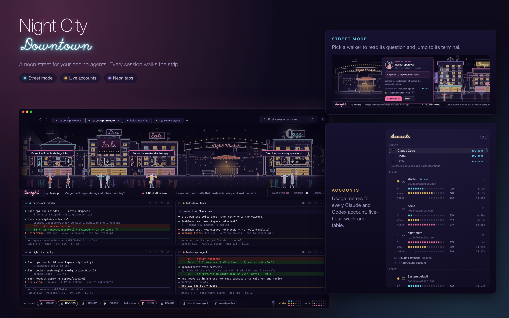

# Night City Downtown

A neon street that keeps your sessions for you: every Claude Code, Codex or Gemini CLI session becomes a walker with a building of its own, so you can see at a glance who needs you, who is still working, and whose result is waiting by the mailbox.



## What it does

- **A street of sessions instead of a list.** Each live session gets a character (suit, dress, hoodie, shopper, phone, kid, puffer or skirt) and a home on a neon street, and keeps both for as long as it exists. The street repeats in blocks of eight buildings; up to four blocks are drawn (16 sessions per block, 64 in all), so the most urgent sessions are the ones on screen.
- **Every state reads from the pavement.** A session waiting for you stands at its door facing you, arms open, with its last question in a pink speech bubble and a blinking alert marker over its head; the building's neon flickers fast. A working session paces at the door. One that has been quiet for ten minutes with nothing running walks the same beat at a third of the speed. A finished result stands by the mailbox, shifting between two poses, with the flag up. A result you have read steps back into the rear lane, fades and floats a `z`.
- **A flyer for the walker you pick.** Status and age, name, ticket and agent, the question, a topic line, checklist progress as lamps, waiting page alerts, and buttons for open, mark read and next. The arrow keys walk the street in urgency order; `↓` opens the checklist's steps on the card.
- **The Tonight ticker.** A 40 px strip under the street runs every session in urgency order, pauses under the pointer, and can be clicked to pick a session. Three counts at its right end filter by needs-you, working and results; `F` cycles the same filters.
- **Street mode.** `⌃⌥P` hands the keyboard to the street: every sign, marquee and gate light goes steady-bright, the dim layer lifts, and picking a walker pans the camera to its door, spotlights it and darkens the rest. `⌃⌥/` opens a 1000×600 key legend from anywhere, and closing it hands the keyboard back where it came from.
- **A neon tab strip.** Back/forward through visited terminals, the active space's tabs with a status dot each, a search box shared with the street (`/`), Files and Changes buttons for the side panel, and a `?` that opens the legend.
- **Licence plates.** A 48 px bar at the bottom groups spaces by repository — spaces of one repository sit together, the base checkout first — labels each plate with its ticket or name, shows up to four walker faces, and keeps the account meters at the right.
- **Account meters and an accounts popup.** Up to four accounts, each with 5h, week and Fable lamps that turn pink past 75 %. Clicking the meter, or `⌃⇧A`, opens a 460×700 popup: agents, Claude accounts, the Claude start command, Codex accounts, custom commands, and "continue this session as". Picking an account row makes it the default; agent and model rows can also open a pane.
- **A pane header and an editor.** The 30 px header names the pane, marks its session's state with a dot and can split, zoom and close. The bundled `night-city-editor` opens a file in a pane beside its terminal through the `hv` launcher, with save, reload after an on-disk change, Markdown preview and "open as a tab".
- **A demo mode for pictures.** `demo: true` on the street, tab strip or plates draws invented sessions, spaces and meters instead of live data; the street can also be told how many invented sessions to show.

## Install

Copy the mods, layout and theme into Herdr's home:

```sh
cp -R mods/night-city-* ~/.config/herdr-app/mods/
mkdir -p ~/.config/herdr-app/layouts ~/.config/herdr-app/themes
cp layouts/night-city-downtown.json layouts/night-city-downtown.png ~/.config/herdr-app/layouts/
cp themes/night-city-downtown.json ~/.config/herdr-app/themes/
```

Merge the `layout:night-city-downtown` section of this package's `keys.json` into `~/.config/herdr-app/keys.json`, adding its keys without replacing ones you already use. (Once the file is edited, Herdr stops adding new default shortcuts to it on upgrade, so the merge is the one edit worth making deliberately.) Then check every mod and switch:

```sh
for mod in night-city-street night-city-tabs night-city-plates night-city-pane night-city-accounts night-city-editor; do
  herdr-app check ~/.config/herdr-app/mods/$mod
done
herdr-app do layout.switch '{"name":"night-city-downtown"}'
```

The layout's hidden side panel uses Herdr's shipped `files` and `changes` mods, and the session and space menus use Herdr's shipped `menu` and `new-menu`; all four come with Herdr and need no copying.

## Keyboard shortcuts

The layout's own section, `layout:night-city-downtown`:

| Key | Action |
|---|---|
| `ctrl-alt-p` | Move the keyboard into the street, and back out |
| `ctrl-alt-/` | Open or close the key legend |
| `ctrl-shift-a` | Open or close the accounts popup above the plates |
| `cmd-=` / `cmd-+` | Bigger terminal text |
| `cmd--` | Smaller terminal text |
| `cmd-0` | Reset terminal text and zoom |
| `cmd-[` / `cmd-]` | Back / forward through visited terminals |

In the street (while it has the keyboard):

| Key | Action |
|---|---|
| `Tab` / `⇧Tab` / `←` `→` | Next / previous session in urgency order |
| `⌥←` `⌥→` | First / last session |
| `Space` / `⇧Space` | Pick a session waiting for you / one with a result |
| `↩` | Go to the picked session's pane |
| `⇧↩` | Open the picked session's page alerts |
| `P` | Open the oldest page alert |
| `M` | Mark a result read; it stays on the street, asleep |
| `⌫` | Clear a result off the street until its next result, or put a stalled session aside for 10 minutes |
| `⌘Z` | Undo the last read mark, clear or put-aside |
| `↓` / `↑` | Expand the picked session's checklist steps / scroll back up and close |
| `⌘↩` | Session menu (`↑` `↓` `↩` `Esc`) |
| `F` | Cycle the status filter |
| `/` | Find a session or ticket (focuses the tab strip's search box) |
| `Esc` | Clear the menu, selection, filter and query, then leave the street |
| `?` | Key help |

In the tab strip: `←` `→` move, `↩`/`Space` select, `⇧←` `⇧→` reorder, `F` files panel, `C` changes panel, `/` search, `M` tab menu, `Esc` leave.

In the plates: `←` `→` move, `↩`/`Space` select the space, `A` accounts, `N` new space, `M` space menu, `Esc` leave.

In the accounts popup: `↑` `↓` move, `↩`/`Space` run the row, `O` open a new pane, `E` or `F2` rename, `Esc` close.

In the editor: `⌘S` save, `⌘R` reload when the file changed on disk, `⌘E` code/preview for Markdown, `⌘O` open as a tab.

Letter keys need an English input source; on a Korean input source the input method takes them first. Space, `⇧Space`, `Esc` and `⌃⌥P` work either way. `⌘⌥↑` and `⌘⌥↓` are Herdr's own `pane.go` keys for moving between the terminal, the street, the tab strip and the plates.

## What it reads and runs

Night City Downtown is local-first. It reads session files on this machine and runs a few bundled scripts; the one connection to the network is an optional usage request made by the accounts mod.

**Reads.** Every 3 seconds the street runs `sh ~/.config/herdr-app/mods/night-city-street/scan.sh`, which uses `python3` to read:

- Claude Code session records and transcripts under `~/.claude` (or `$CLAUDE_CONFIG_DIR`) and under each `~/.claude-accounts/*` that has a `sessions/` folder;
- checklist state under `/tmp/deadhd-state` (`$DEADHD_STATE_DIR`) and the checklist `.json` under `/tmp` that its state file names;
- page alerts under `~/.pulse/pages` (`$PULSE_PAGES_DIR`);
- the handoff note a session's first prompt points at (`…/.claude/handoff/*.md`);
- a thread-memory folder set by `HERDR_THREAD_SESSIONS` and a per-ticket goals file set by `HERDR_GOALS_FILE` (both are read only when the variable is set);
- the newest Codex rollout under `~/.codex/sessions`, and Gemini CLI chats under `~/.gemini` (`projects.json` pairs a folder with its chat slot);
- the processes themselves through `ps` and `lsof` (override with `PULSE_PS` / `PULSE_LSOF`).

It writes nothing but a ledger cache and an identity cache per session under `${TMPDIR:-/tmp}/herdr-pulse`, and never opens a `*.key` file. The plates run `git -C <folder> rev-parse --path-format=absolute --git-common-dir --show-toplevel` for every terminal folder every 30 seconds, to group spaces by repository.

**Runs.** The street opens a page with `open <url>` and then deletes the page's alert files with `rm -f`; it focuses panes with `pane.focus`, attaches a background session with `pane.split` running `claude attach <id>`, switches tmux with `tmux switch-client`/`select-window`/`select-pane`, switches Orca with its command-line tool plus `open -a Orca`, and stops a background session with `claude stop <id>` through `sh -lc`. Its text-size commands are the only writes to Herdr's `settings.json`, changing only `font_size` and `zoom`.

The plates and the accounts popup run the bundled `cca --porcelain [pid]` every 30 seconds; the accounts popup also uses `cca use`, `cca codex use`, `--porcelain-add`, `--porcelain-add-codex`, `--porcelain-add-model` and `--porcelain-rename`, and reads `night-city-launch` and `models.json` from `${XDG_STATE_HOME:-~/.local/state}/herdr-tower`. `cca` is a shell script: it reads account e-mail and plan from `~/.claude.json` and `~/.claude-accounts/*/.claude.json`, the focused session from `~/.claude/sessions/<pid>.json`, process environments with `ps -E`, and usage records under `herdr-tower/usage`; with `node` it also reads `herdr-tower/models.json`, `~/.codex/auth.json` (or `~/.codex-accounts/*/auth.json`) and the newest Codex rollout. Commands you put in `models.json` under `usage` are run through `/bin/sh -c` every 30 seconds and are yours to trust.

**Network.** `cca` asks `https://api.anthropic.com/api/oauth/usage` at most once every five minutes, only when `node` and macOS `security` are present; it sends the Claude Code OAuth token read from the keychain to read the rate-limit windows, including the Fable week. There is no other network access.

**Optional.** `usage-tap.sh` is a status-line hook that records the 5h and week windows for the account the status line runs as; it prints nothing and never breaks the status line. `hv` and `hv-open` are the launchers the editor pane is opened through.

## Requirements

- `python3` for the street's session scan. Without it the street shows a notice with a retry button and no walkers.
- `node` for Codex accounts, custom commands and the Fable window; Claude usage still appears from whatever `usage-tap.sh` recorded.
- `git` to group plates by repository; without it each space is its own group.
- macOS for the keychain part of the usage request.

## Credits

No third-party fonts or artwork are bundled: the scene and the interface pieces are drawn for Night City Downtown, the interface uses Herdr's own type, and monospaced details ask for JetBrains Mono only if it is already installed.

## Licence

MIT — see [LICENSE](LICENSE). Copyright © 2026 Night City Downtown contributors.
