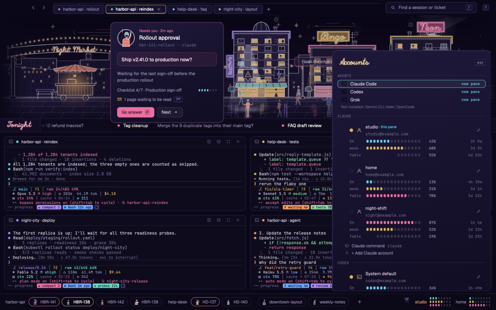

# Night City Downtown

A neon street for Herdr. Eight buildings to a block repeat under a night sky, and every live Claude Code, Codex or Gemini CLI session is a walker who lives at one of their doors: waiting sessions stand at the door with their question in a speech bubble, working ones pace in front of it, results wait by the mailbox with the flag up, and read results sleep in the back lane. Under the street a 40 px ticker runs the sessions in urgency order, the tab strip above the street keeps Herdr's tabs, and a licence-plate bar at the bottom groups the spaces by repository beside their account meters. Everything is drawn in neon on near-black, and no custom font files ship.

## What you see

The window is one column with `theme: "night-city-downtown"`, `background: "#0a0718"`, no title bar, traffic lights at `[16, 15]` and terminal padding 12. Four bands sit top to bottom.

**Top, 44 px, full width, drags the window:** the tab strip, on `#0a0718` with 16 px of left padding (84 px on macOS while the window draws no buttons and is not fullscreen), 16 px on the right, a 14 px gap, and no panel behind it. Left to right: two 26 px history buttons (back, forward, icons 14 px); the tabs. A hairline `#d8d0e233` runs across the strip at y = 9, and a 1×5 px stem hangs from it into the middle of every tab. A tab is 26 px tall, up to 220 px wide, 14 px of side padding, radius 3 above and 7 below, border 1 px `#3a3260`, background `#171230`, 12.5 px type; a 6 px status dot leads it (blocked `#ec6fa2`, working `#5fd0e6`, done `#d8b25c`, idle `#a98bf0`, otherwise `#6a6188`), then the name, truncated at 170 px. The active tab has a mustard `#d8b25c` border, white text, a 12 px close icon, an inset `#d8b25c44` border and a 2 px `#d8b25c66` bar along its bottom. The keyboard cursor is a 2 px `#d8d0e2` ring 3 px outside the tab. The new-tab `+` is a 26 px button after them. Right of the tabs: the street's notice pill (24 px tall, radius 12, up to 320 px, with Undo or Retry words), Files and Changes buttons while the panel exists (26 px, cyan icon when that panel is open), a 264×32 search box (radius 8, `#120e25`, cyan border while focused, a 16 px neon search icon, 13 px text, a `/` key chip), a `?` key chip that opens the key legend, and window buttons (minimise, restore/maximise, close, 26 px) while the window draws its own.

**Street, 340 px to start (200–400), full width:** the street scene over the **Tonight** ticker. The block is all black `#0a0718` with 86 px gradients fading to the window edges. The ticker is 40 px: a 117 px label cell in `#120d22` carrying the `Tonight` sign (85×31 px), then the scrolling tape, then the counts with 16 px of padding and a 10 px gap. The picture is a 1600×200 scene unit block scaled by `1.62 × (block height − 40) / 330`, so the default 340 px block draws at ≈1.47× into a 300 px strip, a 2356×295 px picture pinned to the strip's bottom (5 px of sky above it at 340). One block is eight buildings at scene x 118, 270, 430, 590, 1010, 1168, 1328 and 1484, standing on a ground line at y = 158; a central stall at x = 800, two street lamps at 352 and 1250, trees at 24 and 1580, a bench at 742 and a hydrant at 512; a big screen at 430,92, a marquee at 1010,130 and a gate at 800,162. Behind everything: a sky, 34 stars, four clouds, a moon and a plane. The strip holds as many blocks as the view, the sessions and their homes ask for, from one to four.

A walker is a 60×66 scene unit figure. Two lanes: the front lane (y = 198, scale 1) and the back lane (y = 174, scale 0.8). Eight characters exist: suit, dress, hoodie, shopper, phone, kid, puffer and skirt (the kid walks at 13.94 units/s, the rest at 19.35). Nine unnamed crowd walkers per block cross the back lane at 55 % opacity. A picked walker gets a spotlight and a floor glow in its status colour; the walker whose session is in the focused terminal gets a 34×8 px mustard pill at 45 % opacity under its feet. Every non-crowd walker carries a status marker over its head: a blinking alert for a session that needs you, a steady done/blocked/working/asleep marker otherwise. A session waiting for you also has a 26 px speech bubble with a pink halo and tail, 12 px bold white text over `#171230`, clipped to about 250 px at scale 1 and never under ~14 characters; the walker whose session is in the focused terminal gets a mustard bubble border and tail instead. An asleep walker floats a `z` up from its head.

A session's home puts its building and its place at the door: waiting at `door x + 26×[−1, 1, −2, 2]` by its slot, a result at `mailbox x + 22 + 16×slot`, asleep at `door x + 40 + 18×slot`, working at `door x + 12×slot`.

**Middle, 12 px of padding and gap:** the active tab's panes. The pane area is radius 10, `#0e0b1d`, with a 12 px gap, a 1 px `#2a2348` border and a 1 px `#d8b25c` focus border; `lone` is true and the header is 30 px on top, always shown. The header itself, on `#0e0b1d` with a 1 px `#221c3d` bottom edge and 12 px of side padding: a 14 px terminal icon, a 7 px status dot when a session runs in the pane, the title at 12 px (`#d8d0e2` focused, `#6a6188` not), a mono 11 px ticket key, and 20 px buttons (split right, split down, zoom, close; a mod pane has only zoom and close). A picked session's pane gets a 1 px underline in its tint plus a second faint one 1 px above; a focused pane gets a mustard underline at 55 %. The side panel is a hidden 368 px column (280–900) holding Herdr's shipped `files` and `changes` blocks in a stack that starts on Files.

**Bottom, 48 px:** the licence plates, on `#0b0818` with a 1 px `#2a2348` top edge, 16 px side padding and an 18 px gap, left group to right group. A group names its repository in 12 px semibold `#9d93b8` and holds its plates 6 px apart. A plate is 26 px tall, radius 13, 9 px side padding, a 1 px border (`#d8b25c` and white text when active, `#ec6fa2` when a session in it needs you, else `#2a2348`), up to four 18×18 walker faces, and a 12 px label — the first cast ticket, else a ticket in the space's name, else the name clipped to an 18-character budget. The keyboard cursor is a 2 px `#d8d0e2` ring outside it. A 26 px `+` follows the last group. At the right end, at a 14 px gap, the meter: a 20×28 px meter-head image and up to four accounts. An account block is its label in 12 px semibold (`#d8b25c` for the default account, else `#9d93b8`) beside one to three rows of eight 6×8 px lamps 2 px apart — 5h cyan, week mustard, Fable pink — which all turn pink above 75 %.

**Overlays.** The key legend is a 1000×600 dialog with no frame, radius 14, `#171230` over a `#1d1838`→`#120e25` gradient: a header 39 px tall with the `Night keys` sign 143 px wide and a one-line note, then three 300 px columns 21 px apart. Each group has an 11 px title and 24 px rows (keycap right-aligned in 88 px, 13 px text in 202 px). The accounts popup is 460×700, radius 14, 14 px padding, the same card gradient, a 40 px header with the `Accounts` sign 101×35 px and an `esc` chip, a scrolling list, and an 18 px footer hint. Section labels are 24 px rows of 11 px mono text and a rule. An agent row is 38 px tall, radius 8, with a 16 px icon, the name at 13 px and `new pane` in 11 px mono cyan; an account, Codex or model row is padded 34 px on the left, with a 10 px lamp (filled mustard for the default account), a 20 px neon icon, a 13 px name with `· this pane` in cyan when the session runs as it, an 11.5 px mono e-mail or command, a 20 px pencil, and up to three 16 px usage rows (40 px label, sixteen 8×10 px lamps, a 36 px percentage, the time left, all in 11 px mono). The popup opens 6 px above the plates and 16 px in from the right edge, measured in zoomed pixels.

**The editor pane**, not part of the layout but shipped: a 34 px header on `#0d0a1c` with a 14 px cyan pencil, the file name at 12.5 px, the folder in 11 px mono with the home folder written as `~`, a mustard dot when dirty, Code/Preview chips for Markdown, a Save chip (mustard border when dirty), a Reload chip only when the file changed on disk, and "Open as tab" when the pane shares its tab. The body is `#0e0b1d`; the editor's type comes from Herdr's settings font at 13 px.

**Type and colour.** No font file ships: prose uses Herdr's interface font, and mono details (keycaps, ticket keys, e-mails, percentages, file folders, counts) ask for `JetBrains Mono` by family name. Colours come from `themes/night-city-downtown.json`: background `#0e0b1d`, foreground `#d8d0e2`, selection `#3a3260`, cursor and accent `#d8b25c`, chrome and canvas `#0a0718`, surface and popover `#171230`, raised and hover `#1f1a36`, border and selected `#2a2348`, muted `#9d93b8`, dim `#6a6188`; status colours working `#5fd0e6`, blocked `#ec6fa2`, done `#d8b25c`, idle `#a98bf0`. The mods also use `#0d0a1c` bars, `#0b0818` feet, `#120e25` wells, `#110d22` dark, `#3a3260` a second line colour, `#06040f` as the dim layer, `#ffe6f0` for the ask text, `#1a0f22` for a primary button's text, and a 16-colour ANSI set in the theme.

## How it behaves

**Agent statuses on the street.**

- **Needs you** (pink `#ec6fa2`): stands at the door facing the viewer, alternating between its two `ask` poses every 1.9 s, arms out and shoulders shrugging. The last question (or a blocked checklist step's question) is in the bubble over its head; the alert marker pulses 0.55→1 over 1 s; the building's neon drops out 22 % for a blink every 750 ms; while it is picked, the street's searchlights sweep in 2.4 s instead of 7 s. It counts under **Needs you** and comes first in urgency, the longest wait first.
- **Working** (cyan `#5fd0e6`): paces 35 scene units either side of its door, standing 1.5 s at each end with a 2 px bounce, walking on a four-frame cycle of about 1.5 s. Counts under **Working**.
- **Stalled** (mustard, tired face, `blocked` marker): busy, with no background work running and nothing said for 10 minutes. Same route at 35 % speed and a slower walk cycle, still counted under **Working**. `M` or `⌫` puts it aside for 10 minutes, during which it ranks with working sessions; `⌘Z` undoes that.
- **Result in** (mustard): stands by its mailbox facing left, shifting between two walk frames every 2.86 s, and the mailbox flag is up. Counts under **Results**; newest result first. `M` or `⌫` marks it read and it becomes asleep.
- **Asleep** (violet): steps into the back lane, at 60 % opacity, on its sleeping frame with a `z` rising 12 units over 4.8 s and fading back. It is left out of the ticker unless a filter or a search is active.
- An agent Herdr reports that the scan does not list (any program other than Claude Code) gets a walker too, with its Herdr status. A read mark lives in `localStorage["night-city.seen"]` and is dropped once a good scan no longer lists the session.

**The street and the keyboard.** The street holds the keyboard after `⌃⌥P` (or clicking it). Street mode draws every neon sign, the marquee and the gate light steady instead of blinking and lifts the dim layer; without the keyboard a `#06040f` layer sits over the street at 30 % opacity. With a session picked that layer is 20 % while the street has the keyboard and 50 % otherwise, and the picked walker keeps full opacity while everyone else is halved; sessions hidden by a filter or the search drop to a quarter. Building lights follow the sessions: 100 % for every building while the street holds the keyboard, and otherwise 100 % with an awake session and 8 % empty (or, while something is picked, 100 % for its building, 35 % for an awake one, 5 % for an empty one), transitioning over 1.2 s. Steam rises from a building with an awake session; a building with a result raises its mailbox flag.

**The camera.** With nothing picked it drifts slowly between the two ends of the street — 660 scene units in 28 s, never under 4 s — and stops short of a waiting walker so its bubble is whole. It replans when the set of waiting walkers changes, keeping a running leg, and a resize stops it where it is, clamped into the new range; the picked session's door is reached in 0.7 s. While the keyboard is elsewhere and nothing is picked, the camera also pans (0.7 s) when the walker in the focused terminal comes within 80 px of an edge, to bring it back into view. A picked walker halts where it stands; the others walk at 15 %.

**Hovering, clicking, keys.**

- A walker shows a `name · status` tooltip; clicking it focuses the street and picks it (clicking again unpicks), double-clicking picks it and opens its pane, right-clicking picks it and opens the session menu.
- Clicking the street background focuses the street and unpicks. Clicking a ticker cell picks that session; hovering the tape pauses it. Clicking a count sets or clears that filter, and a filter without a count (stalled, asleep) leaves a chip with the status name that clears it. Clicking the flyer's page row opens the pages; its buttons go to the session, mark it read or pick the next one.
- The session menu can show Open (or **Go answer**), Open pages, Open the ticket, Open the pull request, Copy links, Expand the checklist and Stop the background session, each when the session has it; `↑` `↓` `↩` `Esc` drive it, `⌘↩` opens it.
- The flyer drops rows to fit a short street block — the topic line first, then the pages, then step rows, then the checklist, then the ask's lines down to one; the header, one line of ask and the buttons always stay. `↓` opens the picked session's checklist steps (five rows, the current step centred) and scrolls them down on further presses; `↑` scrolls back and then closes them.
- The street's keys: `Tab`/`⇧Tab`/`←`/`→` step in urgency order, `⌥←`/`⌥→` jump to the first or last, `Space`/`⇧Space` pick the next waiting/result session, `↩` opens the picked session, `⇧↩` its pages, `P` opens the oldest page alert, `M`/`⌫` reads or puts aside, `⌘Z` undoes, `F` cycles the filter, `/` focuses the tab strip's search box, `Esc` clears the menu, then the pick, then the filter, then the query, then goes back to the pane, `?` opens the legend. Letter keys work with an English input source; an input method takes them first otherwise.
- The tab strip: click selects, drag onto another tab moves it, double-click renames, the close button closes, the wheel steps tabs, right-click (or `M`) opens the tab menu, `+` opens the new-tab menu. `←`/`→` move the cursor, `↩`/`Space` select, `⇧←`/`⇧→` reorder, `F`/`C` open the Files/Changes panel, `/` searches, `Esc` goes back to the pane. The panel choice is remembered per space in `localStorage["panels"]`.
- The plates: click a plate to select that space, right-click (or `M`) for the space menu, `+` for a new space, the meter to open the accounts popup. `←`/`→` move, `↩`/`Space` select, `A` accounts, `N` a new space, `Esc` leaves. A plate's tooltip lists the space and its sessions with their statuses.
- The accounts popup: `↑`/`↓` move, `↩`/`Space` run the row (an account makes it the default, an agent starts it, a command edits it, an add row opens a form, a continue row resumes this session under that account), `O` splits a new pane for an agent, account or model row, `E` or `F2` renames an account, Codex account or model, `Esc` closes. It refreshes every 30 s and takes the keyboard 60 ms after opening. Errors show in the footer in pink.
- The pane header: the split and zoom buttons call Herdr; close closes; a mod pane offers only zoom and close.
- The editor: `⌘S` saves (refusing if the file changed since it was read or saved), `⌘R` reloads only when a reload chip is shown, `⌘E` swaps Markdown code and preview, `⌘O` moves the file to a new tab while its tab holds other panes. A missing file opens as an empty new buffer.

**The legend.** `⌃⌥/` (or `?` in the street, or the tab strip's `?`) opens a 1000×600 dialog with six groups: Street, Layout, Tab strip, Plates, Accounts popup and Editor pane. It takes the keyboard, closes on `Esc`, `?` or a click, and hands the keyboard back to the pane it was opened from when the street did not have it.

**What moves.** Nothing is animated from JavaScript frame by frame: walkers move by one `left` transition per leg, the camera by one per pan/drift, the ticker by one linear transition, and every light is a native `loop`.

- Walking sessions: four-frame walk at ~1.5 s per cycle; working walkers bounce 2 px over 520 ms while they stand; stalled walkers at 35 % speed.
- Waiting: `ask` poses alternate every 1900 ms; the alert marker pulses over 1000 ms; the speech bubble has a static halo.
- Results: two walk frames alternate every 2860 ms.
- Asleep: `z` rises 12 units over 4.8 s while its opacity swings between 0.15 and 1 over 2.4 s.
- Crowd: nine back-lane walkers per block crossing the street, turning at its ends; everything else at 15 % while something is picked.
- Street lights: searchlights sweep every 7 s (2.4 s while a picked session needs you); back-row glitter 5.2 s; building glitter 6–11 s per building; neon blinks 3 % every 5–9.9 s per building (22 % every 750 ms when it needs you); screen flipbook 15 s; marquee 700 ms; garland 2.2 s; reflections 1.6 s; gate neon 1 s; stall light 3.2 s, stall steam 1.8 s, stall glow 3.2 s; steam fades in and out over 3.5–5.2 s while rising 7 units over 5–7.2 s; stars 2.5–6.5 s; clouds drifting 120 px over 70–109 s; the plane crosses in 109 s, waits 300 ms and crosses back.
- Selection: the camera pans in 700 ms; the card fades in over 300 ms, slides down 14 px over 420 ms and follows the walker over 700 ms; the floor glow pulses 0.6→1 over 1.2 s.
- The ticker scrolls at 0.04 px/ms with a 120 ms hold at the end of a pass.
- The street's dim layer fades over 600 ms.

## Built from

**Layout.** `layouts/night-city-downtown.json` is one `column` named `root` with `theme: "night-city-downtown"`, `preview: "layouts/night-city-downtown.png"`, `background: "#0a0718"`, `terminal_padding: [12, 12]`, `titlebar: "none"`, `traffic_lights: [16, 15]` and `resizable: false`. Its children:

- `top`: block 44 px, `window_drag: true`, content `{ mod: "night-city-tabs" }`.
- `street`: block `px: 340`, `min: 200`, `max: 400`, content `{ mod: "night-city-street" }`.
- `work`: a `row` with `padding: [12, 12]` and `gap: 12`.
  - `main`: block whose content is `{ tab: "active", pane: { gap: 12, radius: 10, background: "#0e0b1d", lone: true, border: { width: 1, color: "#2a2348" }, focus: { width: 1, color: "#d8b25c" }, header: { content: { mod: "night-city-pane" }, height: 30, position: "top", reveal: "always" } } }`.
  - `panel`: column `hidden: true`, `px: 368`, `min: 280`, `max: 900`, holding a `panel-body` stack (`active: "files"`) of the shipped `files` block and the shipped `changes` block.
- `plates`: block 48 px, content `{ mod: "night-city-plates" }`.

**Each mod and its props.**

- **`night-city-street`** — the street and the ticker. Also the key legend when opened as an overlay. Props: `role` (`"street"` by default; `"legend"` draws the dialog), `autosize` (default true; `false` stops the block following the window), `lang` (`"en"` by default, `"ko"` switches every word including the legend), `demo` (invented sessions, no scan and no Herdr reads), `sessions` (how many invented ones, default 8), `pick` (a demo session id to pick 60 ms after start). Logic is split into `model.js` (scan parsing, status, urgency, seats, search, history, text sizes), `walk.js` (legs, lanes, camera, bubbles), `scene.js` (the picture and one node per walker), `demo.js` (invented sessions) and `manifest.js` (generated sizes/anchors from the art manifests).
- **`night-city-tabs`** — the 44 px strip. Props: `demo` (invented space and tabs, every Herdr command a no-op).
- **`night-city-plates`** — the 48 px bar. Props: `demo`, `openAccounts` (with `demo`, opens the popup 60 ms after start so a picture can show it).
- **`night-city-pane`** — the 30 px header. The app gives it `{ pane, terminal }`; it finds the session in `shared("night-city").cast`.
- **`night-city-accounts`** — the 460×700 popup. Herdr gives it `{ overlay }` (so it can close itself), plus `demo` from the plates. Its `mod.json` declares `overlay: { kind: "popup", width: 460, height: 700 }`.
- **`night-city-editor`** — not in this layout. `hv` opens it beside the terminal with `{ file }`; `{ pane }` is its uid and lets it move itself to a tab. `hv-open` is the Herdr Open applet's launcher.

**Shipped mods used:** `files`, `changes`, `menu` and `new-menu`.

**Herdr functions:** `terminals()`, `agents()`, `panes()`, `spaces()`, `focused()`, `layout()`, `window()` (including `viewport_size()`), `settings()` (zoom and font), `appHome()`, `home()`, `knownAgents()`, `props()`, `shared()`/`setShared()`, `nextCommand()`, `openOverlay()`/`closeOverlay()`, `exec()`, `run()`, `readTextFile()`/`writeTextFile()`.

**Commands called:** `pane.focus`, `pane.split`, `pane.go`, `pane.close`, `pane.zoom`, `tab.select`, `tab.move`, `tab.rename`, `tab.close`, `tab.new`, `tab.prev`, `tab.next`, `layout.resize`, `layout.show`, `layout.hide`, `layout.select`, `space.select`, `space.new`, `space.move`, `window.minimize`, `window.maximize`, `window.close`; and the mod commands `night-city-street.{toggle,legend,legend_closed,font_in,font_out,font_reset,back,forward,retry,next,prev,clear,first,last,pages,oldest_page,read,undo,ask,result,expand,collapse,menu,filter,focus}`, `night-city-tabs.{focus,search,clear,files,changes,left,right,select,move_left,move_right}`, `night-city-plates.{focus,left,right,select,accounts}`.

**Shared state:** `night-city` (`{ sel, lang, cast, counts }`, plus `demoOpen`/`demoFocus` from the demo); `night-city.query` (the search text, written by the tab strip, read by the street); `night-city.accounts` (`{ overlay }`, so the plates can close the popup they opened); `night-city.notice` (`{ tone, text, undo, retry }`, the street's scan error or last action, drawn by the tab strip). It also reads Herdr's `workspace.panels` and keeps two localStorage values of its own: `night-city.seen` and `panels`.

**Programs run.**

- The street runs `sh <appHome>/mods/night-city-street/scan.sh` every 3 s. The script needs `python3` (without it it prints one meta line with an error) and reads Claude Code session records and transcripts, Codex and Gemini CLI session files, `ps`/`lsof` process data, checklist state, page alerts, handoff notes, and two optional thread/goal state files that are read only when `NCD_THREAD_SESSIONS` / `NCD_GOALS_FILE` are set; it writes only its ledger and identity caches under `${TMPDIR:-/tmp}/herdr-pulse`.
- The street opens pages with `open <url>` and deletes their alert files with `rm -f`; it runs `tmux` to switch tmux panes and Orca's binary plus `open -a Orca` for Orca; it splits a pane running `claude attach <id>` for a background session and runs `sh -lc 'claude stop "$1"'` to stop one; its text-size commands rewrite `settings.json` changing only `font_size` and `zoom`.
- The plates run `sh <appHome>/mods/night-city-accounts/cca --porcelain [pid]` every 30 s and `git -C <folder> rev-parse --path-format=absolute --git-common-dir --show-toplevel` for every terminal folder every 30 s.
- The accounts popup runs the same `cca --porcelain [pid]` every 30 s while open, `cca use`, `cca codex use`, `--porcelain-add`, `--porcelain-add-codex`, `--porcelain-add-model` and `--porcelain-rename`, reads `night-city-launch` and `models.json` from `${XDG_STATE_HOME:-~/.local/state}/herdr-tower` through `sh -c`, and opens panes with `pane.split` (`{ direction: "right", argv }`). `cca` is a shell script; with `node` it also runs `models.mjs`, `usage-api.mjs` and `codex-usage.mjs`, and every `usage` command in `models.json` goes through `/bin/sh -c`.
- The editor only reads and writes the file it was given; the tab strip and pane header run no programs.

**Art.** Everything is SVG under `mods/night-city-street/art/`, 3.6 MB in two sets, each with a `manifest.json` of sizes and anchors. `city/` holds 226 files: `bg/` (sky, moon, 2 star poses, 3 clouds, plane and its light, ground, back row, 2 glitter poses, 2 reflection poses, 2 searchlight poses), `buildings/building-1`…`building-8` (base, 2 glitter poses, lit windows, neon, bright neon, flicker neon, mailbox and flag, 3 steam poses), `fx/` (screen and its glow, 4 screen poses, 4 bubble pieces, marquee, 2 marquee poses, 2 garland poses, gate, 2 gate-neon poses, stall, 2 stall lights, 2 stall steams, a stall glow, `z`), `people/<who>/` (8 characters × 4 walk frames, 4 left-facing walk frames, 2 ask poses) and `props/` (2 trees, bench, hydrant, bus stop, streetlamp and its lit pose). `ui/` holds 399 files: `scene/` (spotlight, 4 cursor glows, 5 status markers, sign and post pieces), `panel/` (45 face files — 8 characters × 5 states, the round frame and four lit frames — 32 frame pieces in four tints, meter frame, head and 4 lamp pieces, rules and empty-state art), `icons/` (50 icons), `icons-neon/<tint>/` (50 icons in each of 4 tints), `signs/` (`tonight.svg`, `night-keys.svg`, `accounts.svg`, `downtown.svg`, `sizes.json`), and `tabs/` (tab pieces and status dots). `shared/neon.js` is copied into each mod as `neon.js` because a mod can only import its own folder.

## Watch out

- **The street is px, not weight.** Herdr does not hand a weight child's clamped remainder to its siblings: a street block asking for weight 1 with a 400 px maximum would leave the rest of the window empty instead of giving it to the panes. So the block is `px: 340` in the layout and the street sets it with `run("layout.resize", { id: "street", px })` from `window.viewport_size()`: 30 % of the window height minus the two other fixed bands, clamped to 200–400. The mod subtracts 44 + 48 px for the tab strip and the plates, so a layout that changes either size must change `WINDOW_BANDS_H` too. Before the first resize lands, the layout's 340 px stands. A target within 4 px of the last one is not sent, because every resize relayouts the window. `props.autosize: false` turns the following off.
- **The root does not resize.** `resizable: false` on the root; the street's block still follows the window because the mod asks for it, not because the root can be dragged.
- **The legend hands the keyboard back.** Opening the legend records the pane the keyboard came from; closing it must go through the legend's own `legend_closed` command (its `close()` runs it, and Esc/`?`/click run it) so `pane.focus` returns the keyboard there. Closing it any other way leaves the keyboard stranded on a closed dialog.
- **The "here" mark never creates a selection.** The walker whose session is in the focused terminal is only marked with a mustard pill under its feet. Selecting it would open the flyer while the keyboard is in a terminal; Esc pressed there would then reach the terminal. Picks happen only by click, key or menu.
- **The demo layout is not shipped.** This package holds only `layouts/night-city-downtown.json`. The development repository's demo layout and its `night-city-demo-term` pump invented terminals to fill the middle, and are left out; the `demo` props and `demo.js` fixtures still ship inside the street, tabs, plates and accounts mods and stay inert unless a layout sets them.
- **Caps.** At most 64 sessions are drawn (4 blocks × 16), the least urgent are dropped, and the ticker and the cast passed to the other mods hold only those 64. A block holds 8 buildings and 9 crowd walkers. Up to 4 account meters fit, up to 4 faces per plate, up to 5 checklist rows expanded, 12 lamps in a checklist meter.
- **`python3` is required** by the street: without it `scan.sh` returns one meta line with `python3 not found`, the tab strip shows the error notice with Retry, and the street stays empty. `ps` and `lsof` are overridable with `PULSE_PS`/`PULSE_LSOF`. Codex and Gemini detection depend on them.
- **The accounts side is optional.** Without `node`, `cca` still lists Claude accounts from `~/.claude.json`, but there are no Codex rows, no custom commands and no Fable window, and the meters show only what `usage-tap.sh` already recorded; without macOS `security` the usage endpoint gets no token and no request is made. Without any account directory the meter is empty and the plates still work.
- **`cca` touches the home.** Adding an account creates folders and symlinks in `~/.claude` or `~/.codex`; the popup's add rows run those commands. `models.json`'s `usage` strings are the person's own shell commands and run every 30 s.
- **Letter keys and input methods.** `P`, `M`, `F`, `A`, `N`, `C`, `O`, `E`, `?` and `/` need an English input source; Space, `⇧Space`, `Esc` and `⌃⌥P` work under a Korean input source. The legend says so in its header note.
- **`F2` may be taken.** Herdr's `global` section commonly binds `f2` to `tab.rename`, so the accounts popup also accepts `E` for rename.
- **The layout keys only bind nine shortcuts.** `ctrl-alt-p` is handled both by the binding and by each block's own key handler, because the binding alone does not hand the keyboard back from a focused tab strip or plate row.
- **The panel starts hidden.** It comes back per space from the tab strip's Files/Changes buttons; `ctrl-shift-b` is Herdr's own sidebar toggle, not this layout's.
- **A stale popup id.** A crash can leave `night-city.accounts` set; the plates clear it when they start so the first `A` opens the popup instead of closing nothing.
- **No fonts ship.** `JetBrains Mono` is a family request: a machine without it falls back, and the mono chips grow or shrink a little.
- **Herdr version.** The layout uses per-pane headers (`header` on the `pane` object), `pane.lone`, `layout.resize`, overlays with `at`, `loop`, `window.viewport_size()` and `settings().zoom` from this 0.1.x generation. A fresh build on another version should re-check those first.

## Done when

- `herdr-app check` passes for `mods/night-city-street`, `mods/night-city-tabs`, `mods/night-city-plates`, `mods/night-city-pane`, `mods/night-city-accounts` and `mods/night-city-editor`.
- `herdr-app do layout.switch '{"name":"night-city-downtown"}'` shows the 44 px tab strip, the street with its 40 px Tonight ticker, the pane area with 30 px headers, and the 48 px plates.
- An agent that is waiting makes its walker stand at a door with a pink bubble and a blinking alert marker, adds a **Needs you** count, and `Space` then `↩` goes to its pane.
- A finished agent stands by the mailbox with the flag up and counts under **Results**; `M` marks it read, it steps to the back lane and floats a `z`, and `⌘Z` brings it back.
- `⌃⌥P` moves the keyboard into the street and the signs go steady; `⌃⌥/` opens the 1000×600 legend from a terminal, and closing it returns the keyboard to that terminal.
- `⌃⇧A` opens the 460×700 accounts popup just above the plates, and pressing it again (or `Esc`) closes it.
- Resizing the window changes the street block to 30 % of the height left by the 44 and 48 px bands, clamped to 200–400, and the picture scales with it.
- A terminal whose folder is a git repository groups its space with the other spaces of that repository on the plates, base checkout first.
